

  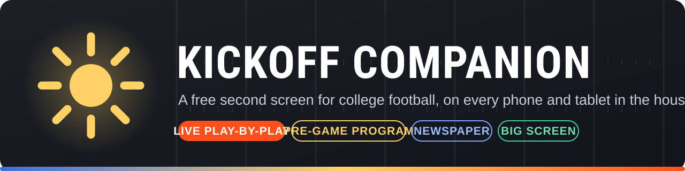

  
  
  
  
  

<b>Pick your team, start it on a Windows computer at home, and follow the game on any phone or tablet on your Wi-Fi.</b> 
The live play-by-play a little behind your TV so nothing is spoiled, the box score, win probability, drives, the shot chart, your team's season, the next opponent's game program, a newspaper, and scores from around the country. No accounts, no cloud, no ads. 
<b>Available for free from Myers Labs:</b> <a href="https://github.com/Myerslabs/kickoff-companion">https://github.com/Myerslabs/kickoff-companion</a>

  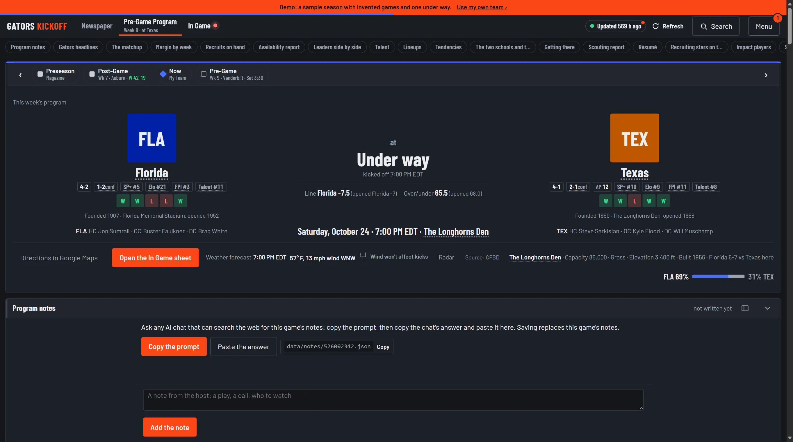

  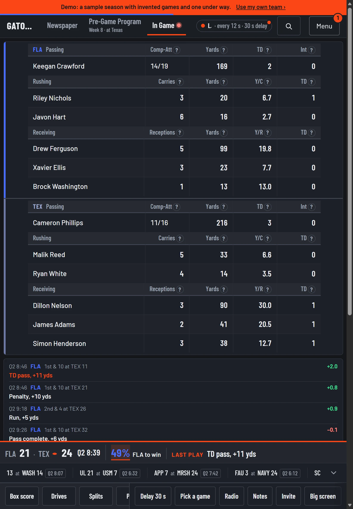
  &nbsp;
  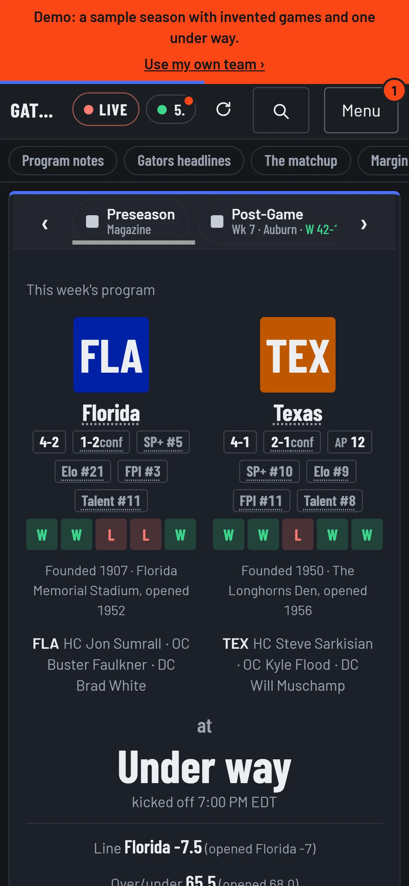

The Pre-Game Program in a browser, In Game on an iPad and the program on a phone, from the built-in demo: real schools and head coaches, invented games, players and scores.

---

## 📖 In this guide

| 🏈 [What's on it](#-whats-on-it) | 🧰 [What you need](#-what-you-need) | 🚀 [Quick start](#-quick-start) |
|---|---|---|
| 🔑 [Your key and your team](#-your-key-and-your-team) | 📱 [Phones and tablets](#-phones-and-tablets) | 📝 [Game notes](#-game-notes-from-any-ai-chat) |
| 👥 [Friends and the big screen](#-friends-and-the-big-screen) | 🔧 [Settings worth knowing](#-settings-worth-knowing) | 🔄 [Updating](#-updating) |
| 🛟 [If something is wrong](#-if-something-is-wrong) | 💬 [Questions](#-questions) | 💻 [For developers](#-for-developers) |

---

## 🏈 What's on it

- 🗓️ **The season as one line.** A row of stops across the top steps through your season, from the preseason magazine to the Pre-Game of the next game, In Game, the Post-Game and, at the end, the season in review. The page that matters now leads.
- 🔴 **In Game.** The score, every play as it happens, team and player stats, win probability, drives, situational splits and a shot chart of each offense's passes and runs, all held back by a **spoiler delay** you set to match your TV. **Pick a game** puts any game of the week on the same sheet.
- 📋 **Pre-Game and Post-Game Program.** The matchup, the poll path and schedule margins of both teams, the whole series, strengths and weaknesses, the lineups drawn on a field, the weather at the stadium, the TV crew and both coaching staffs, players to watch, the injury report and what the conference race needs this week. After the final, the Post-Game keeps the program as it stood at kickoff beside what happened.
- 📰 **The Newspaper.** A front page of your team's headlines with the stories copied in to read on the page, and a Sunday paper after each game. In the off-season a new paper comes out every Monday.
- 📊 **My Team and every other team.** Schedule, results, standings, polls, ratings (SP+, Elo, FPI) and the stat profile behind every rank, each rank one tap from its national list; roster, leaders, recruiting, a card for every player, and the app's own stat grades for each position. Any FBS team's page opens the same way, and every conference has its own page.
- 🗺️ **Talent Edge and the Imperialism Map.** How each roster's recruiting talent compares with its results, and a map of the country redrawn by every game's winner.
- 📚 **Seasons kept.** At the end of a season the app keeps its book (the season in review and every game) and moves to the next season by itself.
- 📝 **Notes.** Schemes, the injury report, depth charts, the TV crew and the coaches come from a prompt the app writes for any AI chat; paste the answer back and the app checks it and saves it.
- ✨ **Claude Code, if you want it.** With [Claude Code](https://claude.com/claude-code) on the computer, the app can run the notes on a schedule, edit the newspaper, write a few pieces of its own, and answer **Ask about this page**. It is off until you turn it on, and each run uses your own Claude plan.
- 📻 **Radio and trivia.** Your team's radio from the bar at the bottom of every page, and game-day trivia for the room.

<table>
  <tr>
    <td width="50%" align="center"><b>The Pre-Game Program</b> 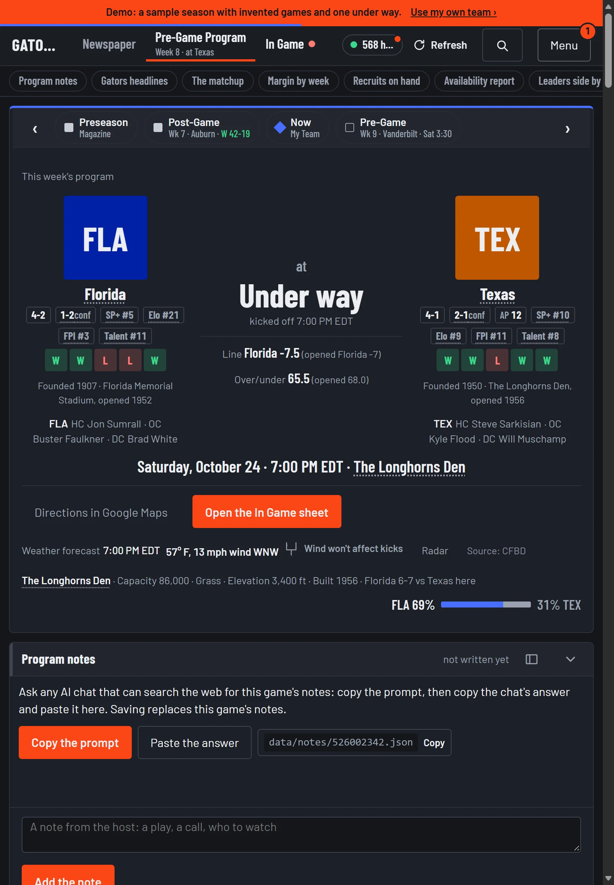</td>
    <td width="50%" align="center"><b>My Team and the season line</b> 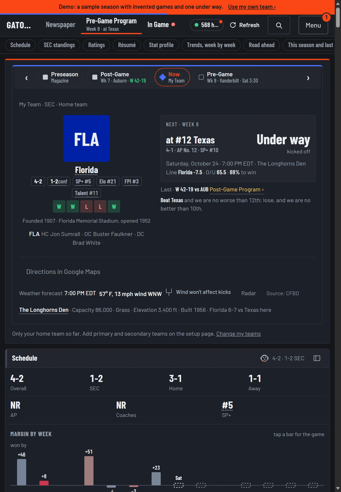</td>
  </tr>
  <tr>
    <td width="50%" align="center"><b>Every conference</b> 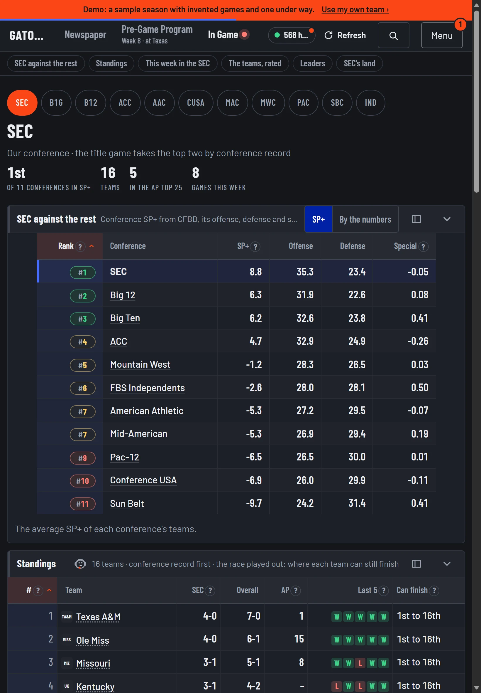</td>
    <td width="50%" align="center"><b>The preseason magazine</b> 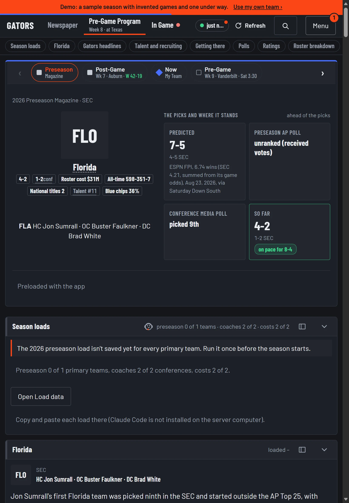</td>
  </tr>
  <tr>
    <td width="50%" align="center"><b>Everything one tap from the menu</b> 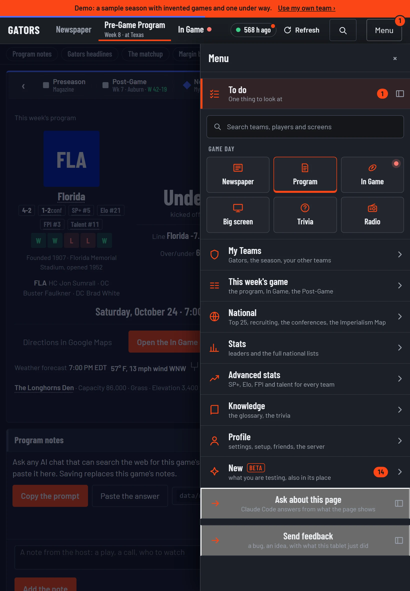</td>
    <td width="50%" align="center"><b>The Newspaper, on a phone</b> 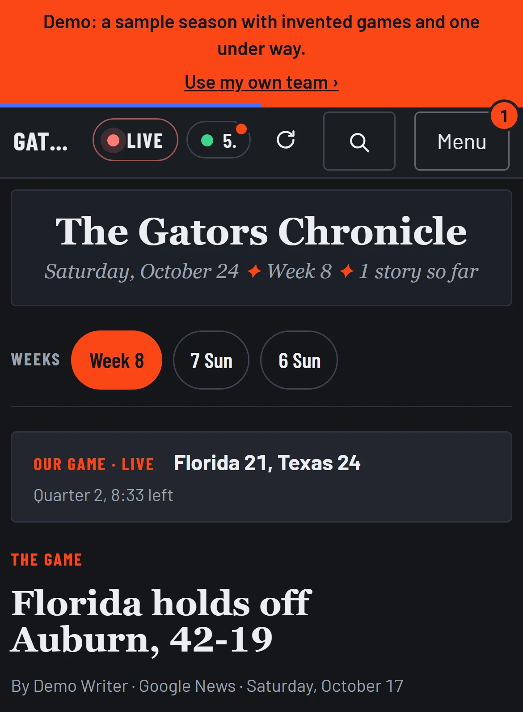</td>
  </tr>
</table>

### How it fits together

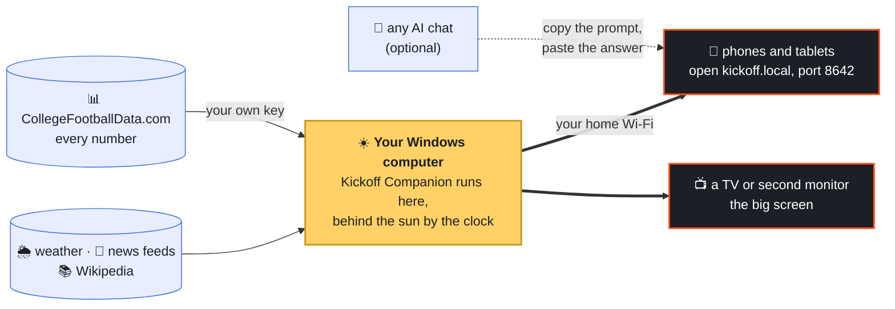

The computer does all the work: it talks to CollegeFootballData.com with your key, keeps what it fetched, and serves the app over your Wi-Fi. Phones and tablets only open a web page, so there is nothing to install on them.

---

## 🧰 What you need

| You need | Why |
|---|---|
| 🖥️ **A Windows 10 or 11 computer** | It runs the app, so it stays on during games. A laptop on its charger is fine. |
| 📱 **Phones or tablets on the same Wi-Fi** | iPhone, iPad, Android, or another computer's browser. |
| 🔑 **A CollegeFootballData key** | Free from [collegefootballdata.com/key](https://collegefootballdata.com/key): sign up with an email address and CFBD mails it to you. You can try the whole app first without one: it starts in a demo. |

> [!NOTE]
> **Your data stays with you.** Kickoff Companion runs on your computer and talks to CollegeFootballData.com (CFBD) directly. Your key, your team and everything you look at stay there; nothing is sent to Myers Labs. CFBD's paid plans are paid to CFBD, not to us, and they only unlock more data.

Every number in the app comes from CFBD, and the plan on your key decides how much the app can show:

| CFBD plan | Calls a month | What the app shows |
|---|---|---|
| 🆓 **Free** | 1,000 | ✅ Every season page, and box scores and play-by-play after each game. The app runs lean so the calls last the month. |
| 🥉 **Tier 1**, $1 a month | 5,000 | ✅ Everything above, plus CFBD's game weather and live scores across the country. |
| 🥈 **Tier 2**, $5 a month (recommended) | 30,000 | ✅ Everything above, plus live play-by-play for your game, more primary teams, secondary teams and the My teams ticker. |

Anything a plan does not include stays on its page with a note saying which plan shows it. Students with a `.edu` or `.ac.uk` address can get CFBD's free Academic key (3,000 calls). See [CFBD's plans](https://collegefootballdata.com/api-tiers).

---

## 🚀 Quick start

### 1. Download and unzip

On the [**Releases page**](https://github.com/Myerslabs/kickoff-companion/releases/latest), take **`KickoffCompanion-<version>-windows-x64.zip`** (the `.sha256` file beside it holds its checksum). Unzip it anywhere (right-click, **Extract All**), for example into your Documents folder, and open the **`KickoffCompanion`** folder inside. In it are the program, also named **`KickoffCompanion`** (with the sun icon), its license and notice, and an **`_internal`** folder it needs: keep them together. Double-click the program.

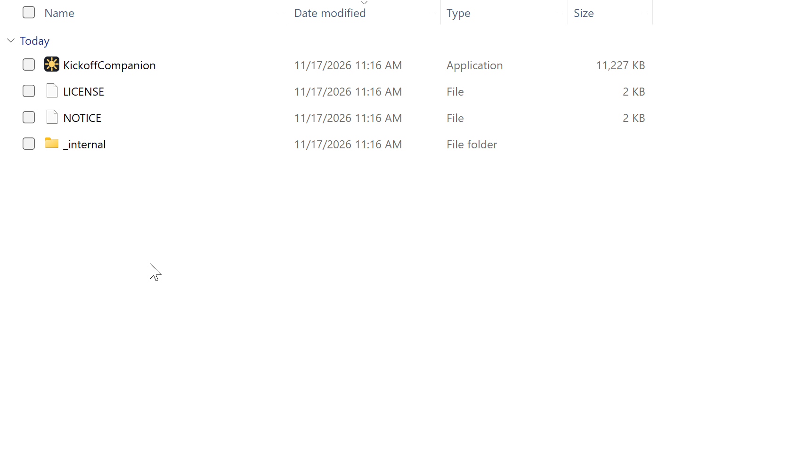

> [!WARNING]
> Take the **`KickoffCompanion-…-windows-x64.zip`** under **Assets**, not **Source code** or **Code, Download ZIP**. Those are the code itself, for developers (see [For developers](#-for-developers)).

### 2. Get past Windows' first-run warnings

> [!IMPORTANT]
> **"Windows protected your PC."** The program is not code-signed yet, so Windows warns the first time you run each download. Click **More info**, then **Run anyway**. "Unknown publisher" is expected until the program is signed.

  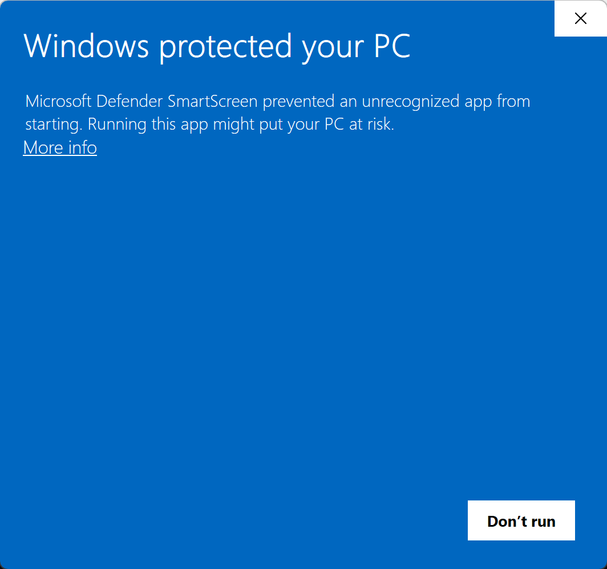
  &nbsp;&nbsp;
  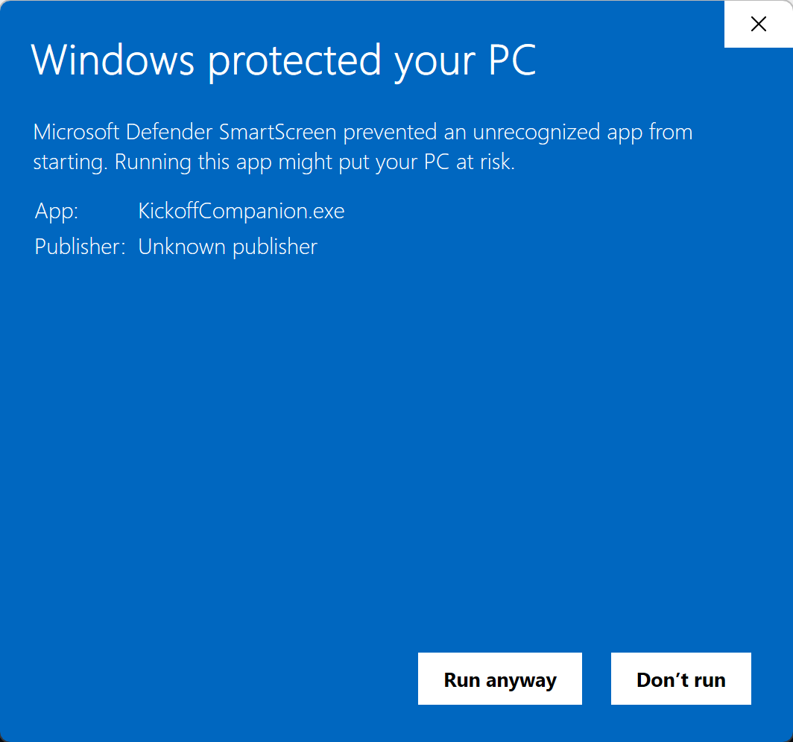

Click <b>More info</b> (left), then <b>Run anyway</b> (right).

> [!IMPORTANT]
> **"Do you want to allow public and private networks to access this app?"** Windows Security asks this on the first start, with the Kickoff Companion sun and Myers Labs as the publisher. Click **Allow**. That is the whole firewall step: it lets the phones on your Wi-Fi reach the app.

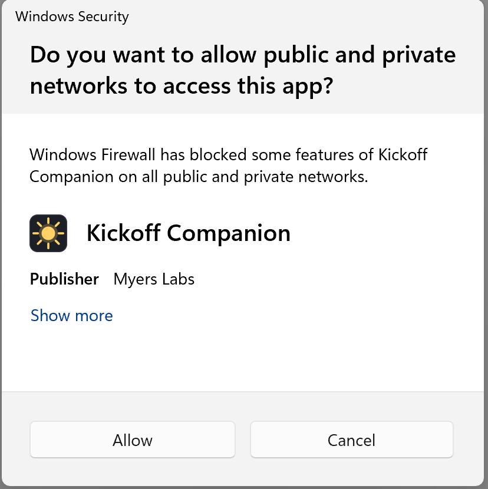

### 3. Find the sun by the clock ☀️

The program is the server, and it runs behind a **sun icon**  in the corner of the taskbar, by the clock. There is no window to keep open.

- **Double-click the sun** to open the app in this computer's browser.
- **Right-click the sun** for its menu: **Open the app**, **Status page**, **Show the log** and **Quit (stops the server)**.
- While it starts, the sun's hover text counts the seconds, and a notification says when the data is ready. Windows labels it **Windows PowerShell**, which runs the sun for the app.

  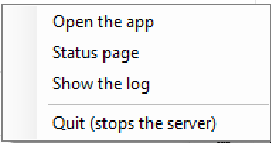
  &nbsp;&nbsp;
  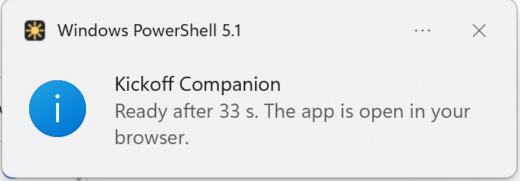

Right-click the sun for its menu (left); a notification says when the app is ready (right).

> [!TIP]
> Don't see the sun? Windows may have tucked it under the **^** arrow by the clock. Drag it onto the taskbar to keep it in sight.

### 4. Look around the demo

The first start opens the **demo** in your browser: a sample season that follows one team, with invented games, players and scores and **a game already under way**, so you can see In Game, the Pre-Game Program, the newspaper and the stats working before you set anything up.

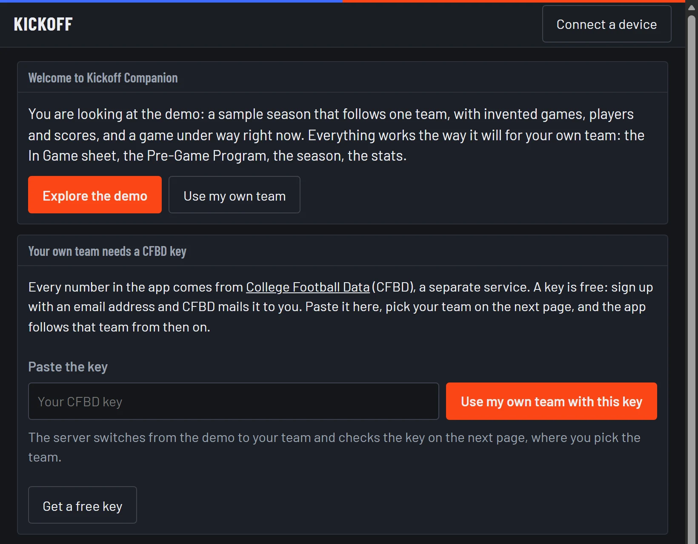

### 5. Switch to your own team

When you are ready, choose **Use my own team** (on the demo's welcome page, or the orange bar across the top of every demo page). The next section walks through it. **Demo**, in Settings under **Setup**, switches back to the demo any time, for showing a friend.

---

## 🔑 Your key and your team

The setup page has four steps. It checks everything with CFBD as you go, and nothing needs editing by hand.

**Step 1. Your CFBD key.** Paste the key and tap **Check the key**. The page asks CFBD and shows your plan: calls a month, used so far, the reset date and a forecast for the month.

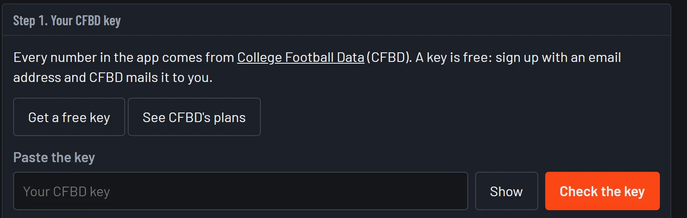

**Step 2. Your primary teams.** Pick your **home team** first. The Season page, the Pre-Game Program and the In Game sheet follow it, and only its colors and mascot theme the app. With a Tier 2 key, add up to four more teams you follow closely; each one's team page loads as soon as a device connects, and the **My Teams** page steps through them in order.

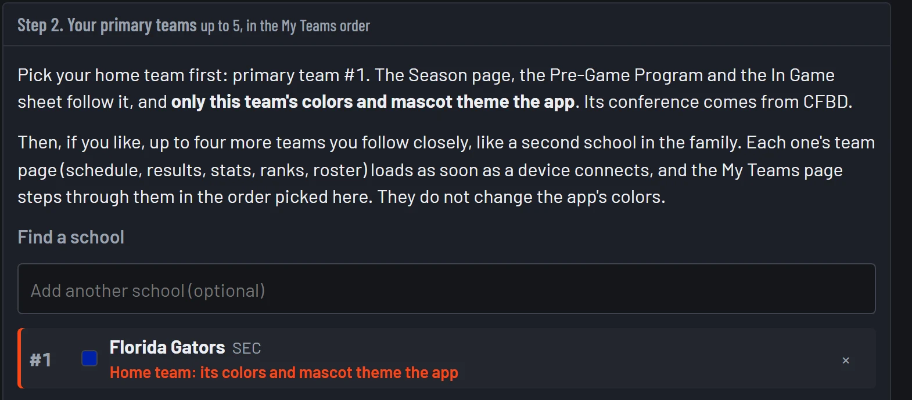

**Step 3. Secondary teams** (Tier 2, optional): single schools, whole conferences, or every school in a state. Nothing loads for them until a page asks, so they cost almost nothing.

**Step 4. The score ticker:** **National** (every FBS game, the default) or **My teams** (Tier 2).

Tap **Save and open the app**. The server restarts with your team and opens the app.

> [!TIP]
> The setup page works from a phone too, as long as no key is set yet. Once a key is saved, it can only be replaced from the computer running the app.

---

## 📱 Phones and tablets

Nothing to install. On the computer, open the **connect page**: **Connect a device** at the top of the setup pages, or the sun's **Status page**. Then:

1. **Scan the QR code** with the phone's or tablet's camera and tap the link it shows. Or type the address: **`http://kickoff.local:8642`**.
2. **Add it to the home screen** so it opens full screen with one tap:
   - 🍎 **iPhone and iPad (Safari):** the Share button, then **Add to Home Screen**.
   - 🤖 **Android (Chrome):** the menu, then **Add to Home screen** or **Install app**.
   - 💻 **Another computer:** bookmark it, or use **Install** in Chrome's or Edge's address bar.

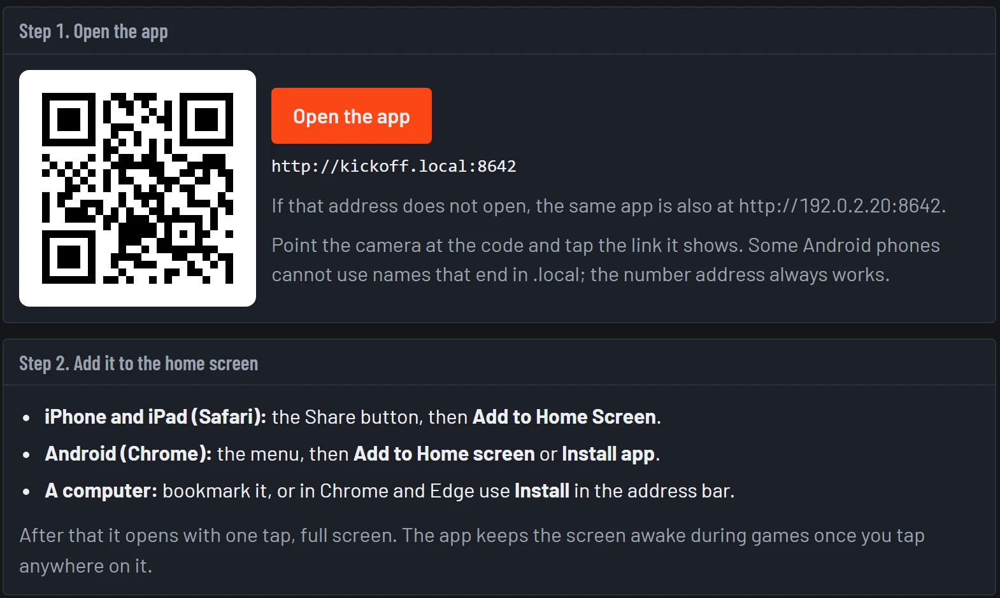

> [!TIP]
> **Some Android phones can't open names ending in `.local`.** Use the number address the connect page shows below the name (it looks like `http://192.168.x.x:8642`); it always works.

> [!NOTE]
> The app keeps the screen awake during games once you tap anywhere on it. Settings, **Keep the screen on**, sets when: game days (the default), always, or never.

The app is served over plain `http://` on your home network, the way most home devices are, so no phone has to install a certificate. Want HTTPS anyway? See [HTTPS, if you want it](docs/05-SETUP.md#https-if-you-want-it).

---

## 📝 Game notes from any AI chat

The Pre-Game Program has a **Program notes** band: schemes, program notes, the injury report, recruits visiting and both depth charts. The app writes a prompt for it; any AI chat that can search the web writes the answer.

1. Tap **Copy the prompt**.
2. Paste it into your AI chat and wait for the whole answer.
3. Copy the chat's **whole** answer.
4. Back in the app, tap **Paste the answer**. The app reads it, checks it and saves it in one step.

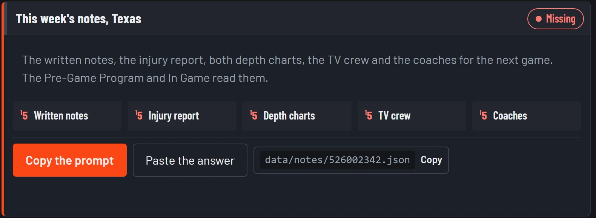

> [!TIP]
> On a phone or tablet over `http://`, the browser won't let the page read the clipboard, so **Paste the answer** opens a box instead: press and hold in it and choose **Paste**. On a computer, Ctrl+V works.

The same copy-and-paste works for the season's other loads (the preseason, the coaches, the roster costs) on the **Load data** page: Settings, **Claude and loading data**, **Open Load data**.

**With Claude Code (optional).** If [Claude Code](https://claude.com/claude-code) is installed and signed in on the computer, Settings, **Claude and loading data**, can switch on **Run the prompts by themselves**: once a day it runs whatever is missing, and a game week adds the notes and the injury reports. It is off until you turn it on, and each run uses your own Claude plan. Without Claude Code, that page shows how to get it, and copy and paste keeps working.

---

## 👥 Friends and the big screen

**Invite friends.** Anyone on your Wi-Fi can watch along: tap **Invite** on the In Game sheet, or open **Invite friends** from the menu, and they scan the code. Nothing to install.

**Make guests view-only.** By default every device can change settings. Set a **host PIN** (Settings, **Friends and the big screen**, from the computer running the app; 4 to 8 digits) and every other device becomes a guest that sees everything and changes nothing. On your own tablet, tap **I'm the host** and enter the PIN once.

**The big screen.** The game for a TV or a second monitor: win probability, leaders, both charts, team stats, the box score, the scores ticker, the radio and a QR code for friends, all on one 1080p screen.

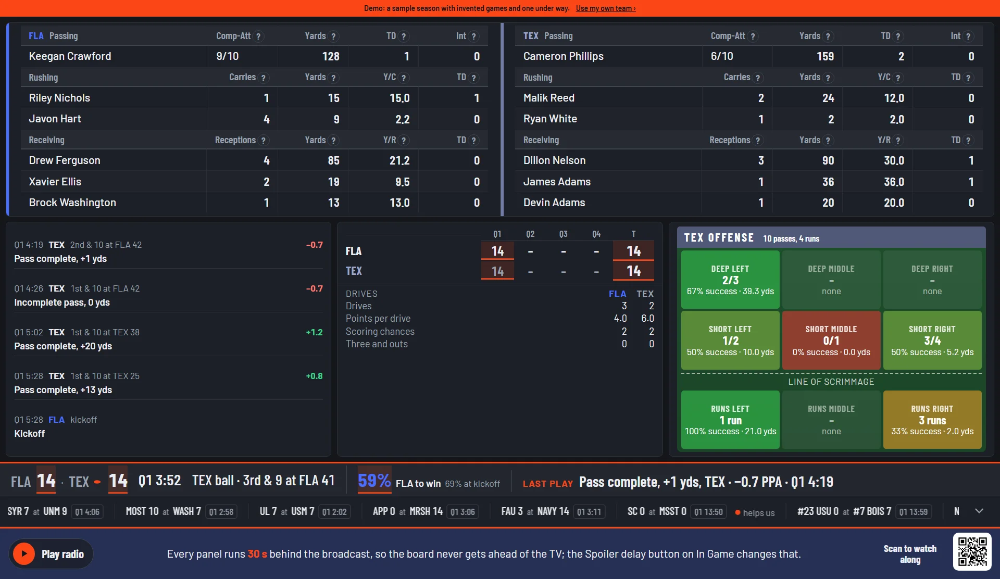

- Open it from the **Big screen** button on the In Game sheet or in the menu.
- To put it on a monitor plugged into the computer: Settings, **Friends and the big screen**, **Big screen**: pick the monitor and **Open the board there**. It opens full screen; **Close the board** puts it away.
- To cast it: open `http://kickoff.local:8642/#board` in any browser and cast that tab to the TV.
- **Leave big screen** (top right, shown when you move the mouse or tap) or **Escape** goes back to In Game.

> [!NOTE]
> The board runs in real time. Match your TV with the **spoiler delay** on the In Game sheet.

**Away from home.** At a tailgate hotspot or a venue's Wi-Fi, turn on **Away from home** in Settings, **Friends and the big screen**: only devices that scanned your code can watch. Turn it off at home. The full guide, including a sign-in page for a travel router, is [docs/07-FRIENDS-AND-THE-BIG-SCREEN.md](docs/07-FRIENDS-AND-THE-BIG-SCREEN.md).

---

## 🔧 Settings worth knowing

Open **Settings** from the menu (**Profile**). The top of the page holds the game-day four; everything else sits in sections below.

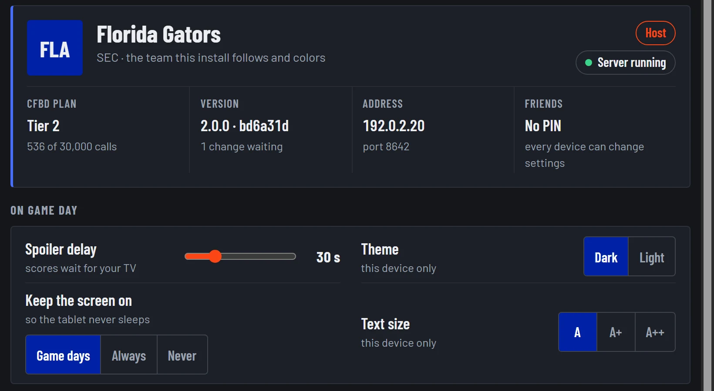

| Setting | What it does |
|---|---|
| ⏱️ **Spoiler delay** | Holds every score and play back so the app never gets ahead of your TV. 30 seconds by default. |
| 🔆 **Keep the screen on** | Game days, always, or never, so the tablet doesn't sleep mid-drive. |
| 🎨 **Theme** and **Text size** | Dark or light, and bigger text, for this device only. |
| 🏫 **Your teams** | Change the home team, primary and secondary teams, or the ticker. |
| 📻 **Radio stations** | Add your team's official station. One team's stations come with the app as a sample; for any other team the app offers a search and a **Request your team's radio** button. |

**Server Settings**, for the computer running the app:

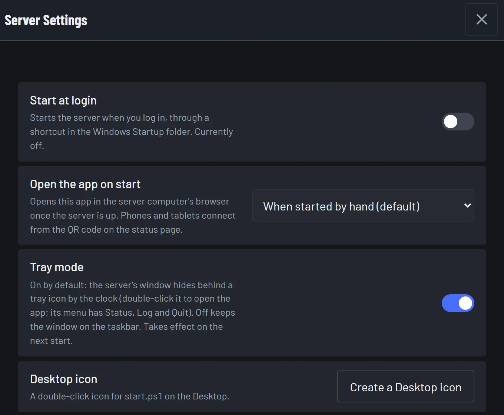

- **Start at login** starts the server when you log in to Windows.
- **Open the app on start**: when started by hand (the default), always, or never.
- **Tray mode** (on by default) keeps the server behind the sun. Off keeps a window on the taskbar instead.
- **Desktop icon** makes a double-click launcher.
- **Nightly backup** zips the archive, notes and settings each night.
- **Keep this computer awake**: while plugged in (the default), the computer never goes to sleep by itself, so the overnight loads run on time; on battery it sleeps as usual.

> [!TIP]
> Your key, settings, notes and archive live in your app-data folder, `%LOCALAPPDATA%\Kickoff Companion`. Settings, **About and help**, **Open the folder** opens it. To keep everything beside the program instead (on a USB stick, say), put an empty file named `portable` next to `KickoffCompanion.exe` before the first start.

---

## 🔄 Updating

**The download:** take the new zip from the [Releases page](https://github.com/Myerslabs/kickoff-companion/releases), quit the sun, delete the old program folder, unzip the new one and start it. Your files are in the app-data folder and stay put. With a `portable` file, move `portable`, `.env`, `data` and `logs` into the new folder first.

**From the code:** Settings, **About and help**, shows new commits on GitHub; **Update now** brings them in and restarts the server. Or `git pull`, then start as usual.

---

## 🛟 If something is wrong

📵 <b>A phone or tablet can't reach the app</b>

- Is the computer awake, and the sun by the clock? Double-click it to check the app opens there.
- Same Wi-Fi? Guest networks often keep devices apart.
- Try the number address from the connect page instead of `kickoff.local`.
- If the Windows Security dialog was dismissed, add the firewall rules in [the setup guide](docs/05-SETUP.md#5-let-viewers-reach-the-host-firewall).
- If Windows shows your home network as **Public**, switch it to **Private** (Settings, Network and internet, your connection).

🔗 <b><code>kickoff.local</code> doesn't open</b>

Use the number address the connect page shows; it always works. Some Android phones don't look up `.local` names. The status page's "network name" line says whether the name is being announced.

🛑 <b>The server won't start</b>

A window opens from the sun with what happened, **Copy the report** and **Show the log**. The log is `logs\app.log` in your app-data folder. `.\KickoffCompanion.exe --check`, run in PowerShell in the program's folder, checks the settings without starting.

🔌 <b>"Port 8642 is taken"</b>

If Kickoff Companion is already running, that copy opens instead of a second one. If another program holds the port, the app names it and offers the next free one: **Use port 8643** saves it, and each device scans the new QR code once.

🔒 <b>A certificate warning</b>

Open the `http://` address, not `https://`. If you turned on **HTTPS for my devices**, trust the certificate once on that device from the connect page.

⏳ <b>How long does a start take?</b>

The sun's hover text counts the seconds while it starts, and a notification says when the data is ready. The very first start builds the demo's season first, which takes about half a minute.

🐛 <b>Something else</b>

Menu, **Send feedback**: describe it, and the report is kept on the computer with what that device just did. Nothing leaves the house until you choose: Settings, **Feedback**, sends a report on to Myers Labs as a GitHub issue or an email from your own mail app.

---

## 💬 Questions

<b>Does it cost anything?</b>

No. Kickoff Companion is free. A CFBD key is free too; CFBD's paid plans only unlock more data and are paid to CFBD.

<b>Can I try it without a key?</b>

Yes. A fresh install opens the demo, with a game under way. **Use my own team** switches when you're ready, and **Demo**, in Settings under **Setup**, switches back.

<b>Why is the app a few seconds behind the live game?</b>

On purpose: the spoiler delay holds scores and plays back so the app never spoils what your TV is about to show. Set it on the In Game sheet or in Settings.

<b>Does anything about me leave the computer?</b>

No. The app fetches only what this guide names: your CFBD data, team logos, public news feeds and the stories they link to, the weather, Wikipedia's pages for teams, coaches and stadiums, and, in a git clone, whether GitHub has new commits (Settings, **Check for updates**, turns that off).

<b>macOS or Linux?</b>

Version 2 runs on Windows 10 and 11. On macOS and Linux, [1.0.1](https://github.com/Myerslabs/kickoff-companion/releases/tag/v1.0.1) (and `uvx kickoff-companion`) keeps working.

<b>Where's the full reference?</b>

[docs/05-SETUP.md](docs/05-SETUP.md) covers every setup option: running from the code, the firewall rules, the network name, HTTPS, the demo and updating. Friends, the big screen and away games are in [docs/07-FRIENDS-AND-THE-BIG-SCREEN.md](docs/07-FRIENDS-AND-THE-BIG-SCREEN.md).

---

## 💻 For developers

FastAPI and plain JavaScript modules, no front-end build step. Every external answer is validated and cached, with retries, a circuit breaker and a monthly call budget, so the app survives a game day unattended and serves the last good data, labelled stale, when CFBD is down.

**From the code:** clone the repository (or **Code, Download ZIP**) and double-click `Kickoff Companion.cmd`. From a downloaded ZIP, Windows first asks "The publisher could not be verified. Are you sure you want to run this software?": click **Run**. The first start installs [uv](https://docs.astral.sh/uv/), Python and the app's packages for your user (no admin rights, a minute or two, once). A clone can update itself later from Settings, **About and help**.

| Task | Command |
|---|---|
| Install | `uv sync` |
| Run with reload | `uv run python -m app --reload` |
| The demo beside your own install (its own port, no key, no network) | `uv run python -m app --demo`, then http://127.0.0.1:8650/ |
| A live game in the demo | `uv run python tools/live_sim.py` |
| Tests (no network) | `uv run python -m pytest` |
| Lint | `uv run python -m ruff check app tools tests` |
| Every page for undefined, null or NaN (headless Edge or Chrome) | `uv run python tools/page_check.py` |
| A month of calls on a key, rehearsed | `uv run python tools/quota_rehearsal.py --tier 0` |
| Build the Windows program | `uv sync --group build`, then `uv run python tools/package/build.py` |

The tests and the demo use a test league: the FBS schools' real names, colors and head coaches, with every game, player and number invented. No CFBD data is in this repository.

## Code signing policy

Free code signing on Windows is provided by [SignPath.io](https://signpath.io), certificate by [SignPath Foundation](https://signpath.org). The release workflow builds the program on GitHub's machines from this repository and submits that build for signing; nothing built anywhere else is signed. Until the first signed release ships, Windows still shows its "protected your PC" note on the first start.

- Committers and reviewers: the maintainer, [Myerslabs](https://github.com/Myerslabs).
- Approvers: the maintainer.
- Privacy: this program does not transfer any information to other networked systems unless specifically requested by the user or the person installing or operating it. From your own computer it fetches only what its documentation names: the data your own CFBD key allows, team logos from CFBD, the public news feeds and the stories they link to, the weather, Wikipedia's pages for the teams, coaches and stadiums, and, in a copy cloned with git, GitHub's new commits when it checks for updates. Claude Code runs only if you turn it on, with your own account. Nothing about you leaves the computer.

## Credits

Data provided by [CollegeFootballData.com](https://collegefootballdata.com). Weather from the U.S. National Weather Service. Fonts: Barlow and Barlow Condensed (SIL Open Font License).

Not affiliated with any school, conference, the NCAA, any broadcaster, or CollegeFootballData.com. See [NOTICE](NOTICE).

## License

MIT, copyright Myers Labs. See [LICENSE](LICENSE).
